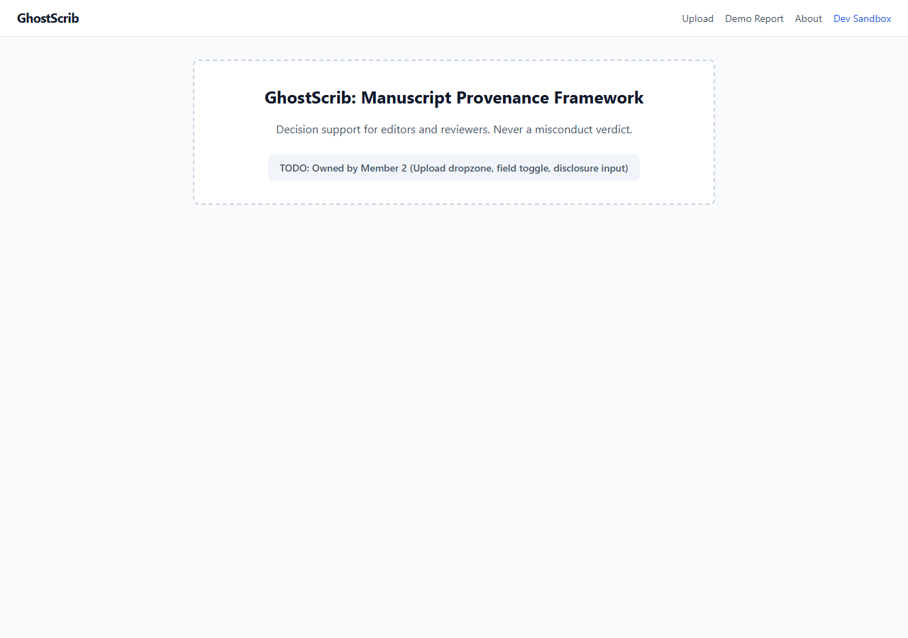
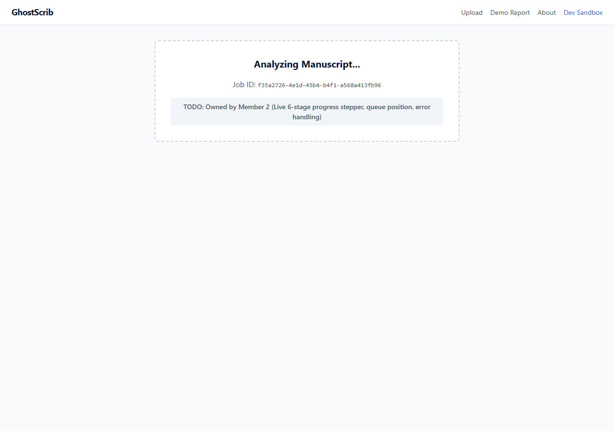
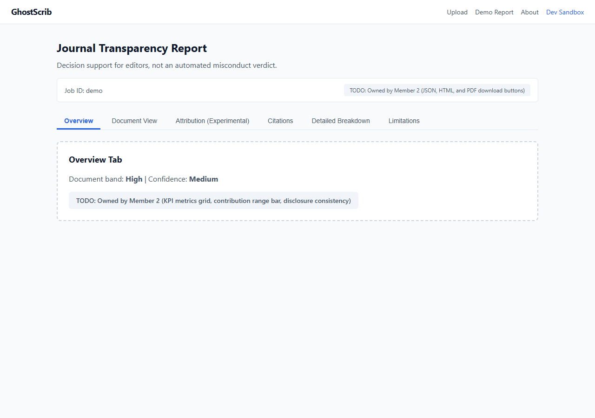
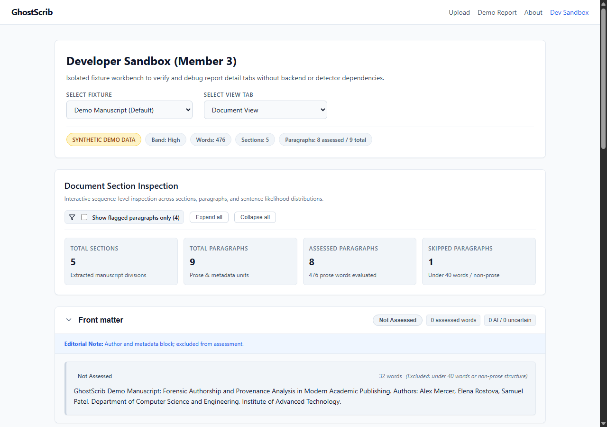
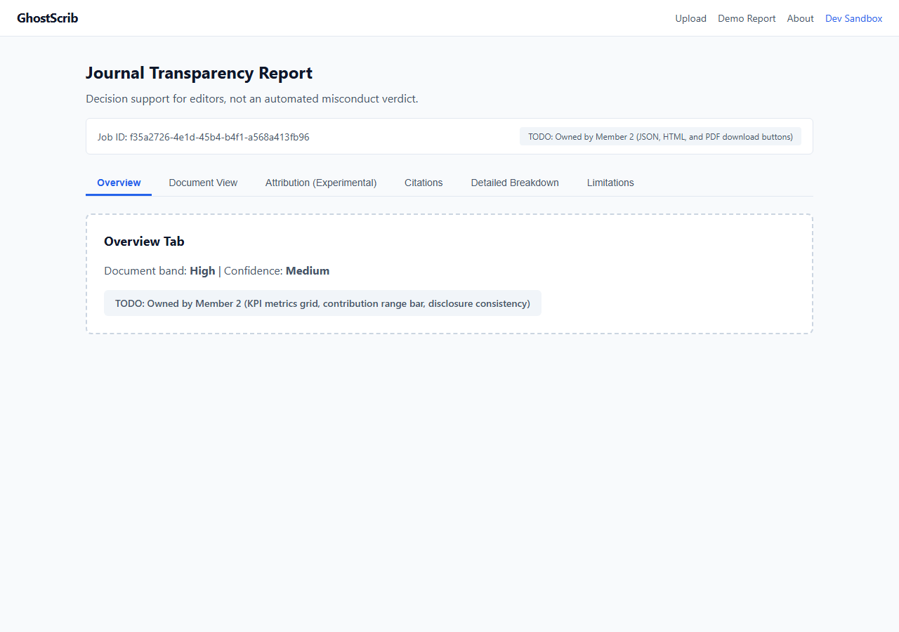

# GhostScrib
**A scientific manuscript provenance and ghost-authorship analysis framework.**

GhostScrib moves the question from *"Was AI used?"* to *"How much, where, and can the authorship claim be trusted?"* It produces graded, evidence-based reports for editors and reviewers instead of a simplistic binary yes/no verdict.

> **Status:** **Full-Stack Web Application (FastAPI + React Vite) & Streamlit Prototype.** This repository contains a production-grade web application with a responsive React 18 front-end, a FastAPI asynchronous backend, and a 5-layer provenance pipeline complete with local DeBERTa ensemble detection, TRACE-inspired attribution, Crossref/OpenAlex citation auditing, and publication-ready PDF/HTML/JSON exports.

---

## Table of Contents

- [Core Principles & Design Stance](#core-principles--design-stance)
- [How GhostScrib Works](#how-ghostscrib-works)
- [Web Architecture & Service Topology](#web-architecture--service-topology)
- [Application Screenshots](#application-screenshots)
- [Journal Transparency Report Output](#journal-transparency-report-output)
- [Tech Stack](#tech-stack)
- [Quick Start Guide](#quick-start-guide)
  - [Prerequisites](#prerequisites)
  - [1. Installation](#1-installation)
  - [2. Setup Third-Party Models](#2-setup-third-party-models)
  - [3. Run the Web Application](#3-run-the-web-application)
  - [4. Streamlit Fallback Prototype](#4-streamlit-fallback-prototype)
- [Running Tests](#running-tests)
- [CLI Evaluation Tool](#cli-evaluation-tool)
- [Repository Layout](#repository-layout)
- [Known Limitations & Disclosures](#known-limitations--disclosures)
- [References & Citations](#references--citations)

---

## Core Principles & Design Stance

1. **Decision Support, Never a Verdict:** GhostScrib assists editorial and peer review workflows with transparent evidence. It never delivers automated misconduct accusations.
2. **No Bare Percentages or Binary Flags:** Every evaluation is presented as a confidence-graded band (`Low`, `Medium`, `High`, or `Insufficient text`) accompanied by explicit reasoning and contribution ranges.
3. **Neutral, Non-Accusatory Terminology:** Findings are framed objectively (`resembles AI-generated text`, `could not be verified`, `possible mismatch`), strictly avoiding terms like "cheating", "fraud", or "fake".
4. **Local-First Privacy:** Manuscript prose never leaves the local machine. Only sanitized bibliographic strings are queried against Crossref and OpenAlex APIs for citation verification. Uploaded files are processed in-memory or in isolated temporary buffers and purged immediately.
5. **No Synthetic Fabrication:** Real benchmark models and deterministic heuristic rules are used. Synthetic demo datasets are explicitly tagged with `SYNTHETIC DEMO DATA`.

---

## How GhostScrib Works

GhostScrib operates as an end-to-end 5-layer pipeline that ingests academic manuscripts in PDF, DOCX, or TXT format alongside the authors' declared AI disclosure statement:

```
Manuscript (PDF / DOCX / TXT) + AI Disclosure Statement
                       │
                       ▼
Layer 0: Parsing & Sanitization  (PyMuPDF / python-docx / regex)
         - Multi-column reading order correction
         - Front matter (title, authors) isolation [not assessed]
         - Bibliography separation and disclosure statement detection
                       │
                       ▼
Layer 1: Primary Detection & Stylometry  (Lukkinen DeBERTa-v3 / spaCy)
         - Local DeBERTa-v3 domain ensemble (0.5% calibrated FPR)
         - Sentence-level classification & highlight scores
         - 12 syntactic/structural traits compared to 240 human arXiv papers
                       │
                       ▼
Layer 2: Attribution [Experimental]  (TRACE-inspired GPT-2)
         - Token transition probability matrices & rank-bucketing
         - Safeguards: Activated ONLY when document length >= 10,000 tokens
                       │
                       ▼
Layer 3: Bibliographic Citation Integrity  (Crossref / OpenAlex / RapidFuzz)
         - DOI and title verification with token-sort fuzzy matching
         - Out-of-range in-text citation index audits
         - Persistent on-disk caching (data/cache/citations.json)
                       │
                       ▼
Layer 4: Provenance Aggregation & Confidence  (Deterministic Rules)
         - Section-level bands with isolated flag exemption (8% human base rate)
         - Document band calculation (requires >= 3 assessed paragraphs)
         - Provenance confidence scoring (volume, trait agreement, detector margin)
         - Disclosure consistency matching matrix
                       │
                       ▼
Layer 5: Journal Transparency Report  (React Web UI / Streamlit / PDF / HTML / JSON)
         - Interactive multi-tab evidence explorer
         - Color-blind accessible badges & sentence highlights
         - Publication-ready PDF export via ReportLab
```

---

## Web Architecture & Service Topology

```
+-------------------------------------------------------------------------+
| Browser Client                                                          |
|  * Dev Mode:        http://127.0.0.1:5173  (Vite Dev Server)            |
|  * Production Mode: http://127.0.0.1:8000  (FastAPI static mount)       |
+------------------------------------+------------------------------------+
                                     |
                                     | HTTP REST & SPA Routing
                                     v
+-------------------------------------------------------------------------+
| FastAPI Application (port 8000)                                         |
|  * /api/health          - Cluster and detector service telemetry        |
|  * /api/analyze         - Multipart upload validation & async queue     |
|  * /api/jobs/{id}       - Stage progression & live status polling       |
|  * /api/jobs/{id}/report- Completed JSON Transparency Report            |
|  * /api/jobs/{id}/export- JSON / HTML / PDF report export downloads     |
|  * /api/demo-report     - Synthetic demo report for instant evaluation  |
|  * Single-Worker Queue  - Protects GPU VRAM from multi-tenant thrashing |
+------------------------------------+------------------------------------+
                                     |
                                     | Python Pipeline Calls
                                     v
+-------------------------------------------------------------------------+
| GhostScrib Core Pipeline (ghostscrib/)                                  |
|  * Layer 0: PyMuPDF / python-docx multi-column parsing                  |
|  * Layer 1: Stylometric trait profiling & z-score baselines             |
|  * Layer 2: TRACE-inspired candidate attribution (GPT-2 CPU)            |
|  * Layer 3: Crossref & OpenAlex bibliographic auditing                  |
|  * Layer 4: Deterministic provenance confidence aggregation             |
|  * Layer 5: Exporters (ReportLab PDF, standalone HTML, raw JSON)        |
+------------------------------------+------------------------------------+
                                     |
                                     | Loopback HTTP (127.0.0.1:8790)
                                     v
+-------------------------------------------------------------------------+
| Lukkinen AI Text Detector Microservice (port 8790)                      |
|  * Dedicated venv in third_party/ai-text-detector                       |
|  * DeBERTa-v3-base dual-model OR ensemble (~1.5 GB weights)             |
|  * Sentence-level classification & highlight scores                     |
+-------------------------------------------------------------------------+
```

---

## Application Screenshots

All screenshots were captured live against the running application:

### 1. Clean Landing Page & Manuscript Upload Form


### 2. Live Asynchronous Stage Progression Screen


### 3. Journal Transparency Report Overview Tab (6 Core Metrics)


### 4. Interactive Document View Tab (Sentence-Level Highlighting)


### 5. Live Analysis of Real Peer-Reviewed Paper (`1-IJCSE-2026-7515.pdf`)


---

## Journal Transparency Report Output

The **Journal Transparency Report** provides editors and reviewers with structured evidence across five core dimensions:

| Metric | Output Range | Description |
|---|---|---|
| **Human Contribution** | `[min %, max %]` | Estimated proportion of assessed prose matching authentic human academic writing. |
| **AI Contribution** | `[min %, max %]` | Estimated proportion of assessed prose resembling automated or AI-assisted drafting. |
| **Document Band** | `Low` / `Medium` / `High` / `Insufficient text` | Multi-paragraph aggregate resemblance band. |
| **Provenance Confidence** | `Low` / `Medium` / `High` | Epistemic certainty based on text volume, unassessed ratio, trait agreement, and model margin. |
| **Disclosure Consistency** | `Consistent` / `Possible mismatch` / `Cannot assess` | Cross-comparison between declared author statement and empirical findings. |
| **Citation Integrity** | `X of Y verified (Z unverified)` | Bibliographic check across Crossref and OpenAlex. |
| **Flagged Sections** | Section names (e.g. `Introduction`, `Methods`) | Specific sections exceeding threshold flags. |

---

## Tech Stack

### Web & API
- **Backend API:** FastAPI, Uvicorn, Pydantic v2
- **Frontend App:** React 18, Vite 5, TypeScript 5, React Router 6
- **Styling:** Design-token CSS variables, dark/light theme support
- **Icons:** Lucide React
- **Frontend Testing:** Vitest, React Testing Library, jsdom

### Core Forensic Engine
- **Document Ingestion:** PyMuPDF (`fitz`), python-docx
- **Primary AI Detection:** Lukkinen AI Text Detector (`lucadagati/ai-text-detector`) with `DeBERTa-v3-base` weights (`Lukkinen/ai-text-detector`)
- **Attribution Engine:** TRACE-inspired token transition framework using Hugging Face Transformers (`gpt2` on CPU)
- **Integrity & NLP:** Crossref API, OpenAlex API, RapidFuzz, spaCy (`en_core_web_md`)
- **Report Generation:** ReportLab (vector PDF generation), HTML5/CSS3, Pydantic v2 schemas
- **Fallback Prototype:** Streamlit, Altair

---

## Quick Start Guide

### Prerequisites
- Python 3.10+ (tested up to Python 3.14)
- Node.js 20+ LTS and npm
- Git
- NVIDIA GPU with 4 GB+ VRAM recommended (runs on CPU with slightly longer inference times)

### 1. Installation

Clone the repository and create a Python virtual environment:

```bash
git clone https://github.com/SamuelRHP/GhostScrib.git
cd GhostScrib

# Create and activate virtual environment
# On Linux / macOS:
python3 -m venv .venv
source .venv/bin/activate

# On Windows (PowerShell):
python -m venv .venv
.\.venv\Scripts\Activate.ps1
```

Install core dependencies:

```bash
pip install -r requirements.txt
```

### 2. Setup Third-Party Models

Provision the isolated detector environment and download the DeBERTa model weights (~735 MB):

```bash
python scripts/setup_third_party.py
```

### 3. Run the Web Application

GhostScrib provides cross-platform orchestration scripts that run identically on Windows, macOS, and Linux:

#### Option A: Production Single-Port Runner (Judge-Ready Demo)

Builds the frontend bundle (if missing), starts the detector service, and serves the unified web application on a single port:

```bash
python scripts/serve.py
```

Open your browser to **`http://127.0.0.1:8000`**.  
- **Instant Demo:** Click **Demo Report** in the header to view a complete synthetic report without uploading.
- **Upload Manuscripts:** Drag-and-drop any `.pdf`, `.docx`, or `.txt` manuscript on the homepage to start live analysis.
- **API Documentation:** Interactive Swagger documentation is available at **`http://127.0.0.1:8000/docs`**.

#### Option B: Development Dual-Server Runner

Starts the detector microservice (port 8790), the FastAPI backend with live reload (port 8000), and the Vite dev server with hot module replacement (port 5173):

```bash
python scripts/dev.py
```

Open your browser to **`http://127.0.0.1:5173`**.

#### Building Web Assets Directly

To compile the production React application bundle independently (used by `scripts/serve.py`):

```bash
python scripts/build_web.py
```

#### Managing the AI Text Detector Service Directly

Control or verify the local DeBERTa-v3 detector microservice on port 8790 independently:

```bash
python scripts/start_detector.py status
python scripts/start_detector.py start
python scripts/start_detector.py stop
```

### 4. Streamlit Fallback Prototype

The original Streamlit prototype remains fully operational as a fallback demo:

```bash
# Ensure detector is running
python scripts/start_detector.py start

# Launch Streamlit
streamlit run app/streamlit_app.py
```

Open your browser to `http://localhost:8501`.

---

## Running Tests

GhostScrib includes comprehensive automated test suites for both backend and frontend:

### Backend Tests (pytest)
```bash
pytest tests/ -v
```
*82 unit and integration tests covering REST endpoints, async job lifecycle, error handling, document extractors, stylometry, citation integrity, coverage metrics, and attribution safeguards.*

### Frontend Tests (Vitest)
```bash
cd frontend
npm run typecheck
npm run test
```
*57 tests across 11 test files covering TypeScript type-checking, tabs, highlights, filter controls, landing page, and developer sandbox.*

### Live End-to-End Verification
```bash
python scripts/verify_e2e_full.py
```
*Executes the complete live pipeline against real PDF, DOCX, and TXT manuscripts, verifies exports, checks all failure modes, and captures browser screenshots.*

---

## CLI Evaluation Tool

Evaluate a batch of labelled manuscripts from the command line:

```bash
python scripts/evaluate_samples.py --samples-dir data/samples --format markdown
```

---

## Repository Layout

```
GhostScrib/
├── api/                         # FastAPI backend service
│   ├── main.py                  # Application entry point & SPA static mount
│   ├── job_manager.py           # Thread-safe async job queue & worker thread
│   ├── validation.py            # Upload security & header validation
│   ├── errors.py                # Standard error envelope models
│   └── routes/                  # REST route controllers (analyze, jobs, export, health, demo)
├── frontend/                    # React 18 + Vite 5 + TypeScript SPA
│   ├── src/
│   │   ├── pages/               # HomePage, AnalyzingPage, ReportPage, AboutPage, DevSandbox
│   │   ├── features/report/     # OverviewTab, ExportBar, tabs/ (Document, Citations, etc.)
│   │   ├── api/                 # Strongly-typed API client & mock runner
│   │   └── types/               # Generated and canonical TypeScript report models
│   ├── package.json
│   └── vite.config.ts
├── ghostscrib/                  # Core 5-layer forensic engine
│   ├── config.py                # Tunable thresholds & environment settings
│   ├── schema.py                # Pydantic v2 data models
│   ├── pipeline.py              # End-to-end 5-layer orchestrator
│   ├── parsing/                 # PDF, DOCX, TXT extraction, cleaning & sectioning
│   ├── detection/               # Lukkinen HTTP client & service launcher
│   ├── stylometry/              # Layer 1: Stylometric traits & z-score baselines
│   ├── attribution/             # Layer 2: TRACE-inspired candidate attribution
│   ├── integrity/               # Layer 3: Crossref & OpenAlex citation auditing
│   ├── provenance/              # Layer 4: Section/Doc bands & disclosure matching
│   └── report/                  # Layer 5: PDF, HTML, and JSON report generators
├── app/
│   └── streamlit_app.py         # Streamlit UI fallback demo
├── scripts/
│   ├── dev.py                   # Development dual-server launcher
│   ├── serve.py                 # Production single-port launcher
│   ├── build_web.py             # Frontend production bundle builder
│   ├── setup_third_party.py     # Clones & provisions third-party detector
│   ├── start_detector.py        # Detector service controller & health probe
│   └── export_openapi.py        # Exports OpenAPI JSON specification
├── docs/                        # Architecture, Contract, Third-Party Notices, Build Logs
│   ├── ARCHITECTURE.md          # End-to-end system and web architecture
│   ├── WEB_CONTRACT.md          # Shared API & frontend contract
│   ├── THIRD_PARTY.md           # Open-source attributions and licenses
│   └── screenshots/web/         # Live application screenshots
├── requirements.txt
└── README.md
```

---

## Known Limitations & Disclosures

In accordance with GhostScrib's non-negotiable ground rules and transparency standards:

1. **Domain Calibration:** The primary DeBERTa detection ensemble was trained and calibrated on English computer-science and engineering academic prose. When evaluating manuscripts outside computer science/engineering, GhostScrib automatically issues a domain warning and moderates confidence.
2. **Base-Rate False Positives:** In human academic writing, approximately 8% of authentic papers contain isolated flagged paragraphs due to formulaic phraseology or common boilerplate. GhostScrib accounts for this by requiring multiple flagged paragraphs across distinct sections before elevating the document band.
3. **Paraphrase & Detector Evasion:** Detector-guided rewriting and advanced paraphrasing tools can reduce detection confidence. GhostScrib counters this by cross-verifying stylometric traits and citation integrity rather than relying on a single classifier.
4. **Unseen Model Families:** Small open-weight models (e.g. 7B/8B parameter models) unseen during detector pre-training exhibit reduced detection recall (~59%).
5. **Non-Native English (ESL/EFL):** Non-native English authors frequently employ standardized academic phrasing that can trigger false positives on simplistic detectors. GhostScrib lowers confidence when vocabulary diversity is constrained without extreme syntactic skew.
6. **TRACE Attribution Constraints:** As established by Shetty et al. (arXiv 2603.28054), LLM token-transition attribution requires book-length text (>10,000 tokens) to achieve statistical significance. GhostScrib marks attribution as strictly experimental and disables it when manuscripts fail this length requirement.

---

## References & Citations

1. **Lukkinen AI Text Detector:** Dagati, L. (2024). *Ensemble DeBERTa-v3-base Detectors for Academic Manuscripts*. MIT License. Code: [github.com/lucadagati/ai-text-detector](https://github.com/lucadagati/ai-text-detector). Weights: [huggingface.co/Lukkinen/ai-text-detector](https://huggingface.co/Lukkinen/ai-text-detector).
2. **TRACE Attribution:** Shetty et al. (2024). *Who Wrote the Book? Detecting and Attributing LLM Ghostwriters*. EMNLP Main / arXiv:2603.28054. Code: [github.com/anudeex/TRACE](https://github.com/anudeex/TRACE).
3. **GhostWriter Benchmark:** ACL Anthology (2026). *GhostWriter: Evaluating Mixed-Authorship and AI-Assisted Academic Text*. LREC 2026.
4. **AI Authorship & Integrity:** Floridi, L. (2024). *AI and the Future of Publishing: Not Detection, but Answerability*. SSRN 6993460.
5. **Detection in Academic Publishing:** PMC10791078. *Detecting manuscripts written by generative AI*.

---

*GhostScrib — Avishkar Hackathon · Team CTRL ALT DELIGHTED*
