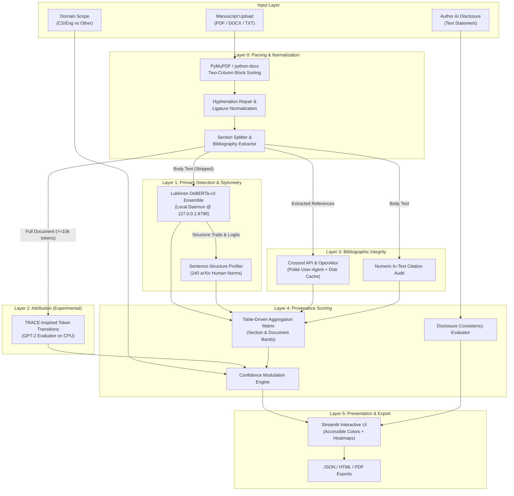

# GhostScrib: Architectural Design & Implementation Specification

## 1. System Overview

GhostScrib is a forensic manuscript analysis framework designed to assist scientific journal editors, program chairs, and peer reviewers. Rather than reducing the evaluation of AI involvement to an opaque, binary percentage ("72% AI"), GhostScrib produces structured, multi-dimensional transparency reports.

### High-Level Architectural Flow

---

## 2. Component Specifications

### 2.1 Layer 0: Parsing & Sanitization (`ghostscrib/parsing`)
- **PyMuPDF (`fitz`):** Multi-column academic PDFs are sorted by column bounding boxes ($x_0 \lessgtr \text{mid}_x$) before sorting by vertical coordinate $y_0$.
- **Hyphenation & Ligatures:** Restores words hyphenated across linebreaks (`micro-\nstructure` $\to$ `microstructure`) and normalizes standard typographical ligatures (fi, fl, ff).
- **Front Matter Isolation:** All metadata preceding the first recognized section heading (`Abstract` or `Introduction`) is classified as `Front matter` and marked `not_assessed` (excluded from model evaluation).
- **Bibliography Cutting:** The `References` / `Bibliography` section is extracted and stripped from the body to ensure references are never sent to the classifier.

### 2.2 Layer 1: Primary Detection & Stylometry (`ghostscrib/detection`, `ghostscrib/stylometry`)
- **Detector Service:** Isolated Python virtualenv hosting Luca D'Agati's `ai-text-detector` (`server.py`). Communicates over local loopback HTTP (`http://127.0.0.1:8790/api/detect`).
- **Ensemble Mechanics:** OR-ensemble of domain-tuned `DeBERTa-v3-base` models calibrated at 0.5% FPR each ($\le 1.0\%$ ensemble FPR on English CS/Engineering academic prose).
- **Whole-Document Request Mapping:** The body text is evaluated in a single request to obtain global `structure_traits` (z-scores against 240 human arXiv papers). Returned paragraph objects are mapped back to section models.
- **Stylometric Agreement:** Evaluates whether structural extreme traits ($|z| \ge 2.0$) corroborate or contradict the classifier verdict.

### 2.3 Layer 2: Forensic Attribution (`ghostscrib/attribution`)
- **TRACE-Inspired Profiler:** Implemented based on Shetty et al. (EMNLP / arXiv 2603.28054).
- **Evaluator Model:** `gpt2` operating on **CPU** (configurable via `GHOSTSCRIB_DEVICE`).
- **Feature Extraction:** 22-dimensional feature vector combining 4 rank bucket frequencies, a $4 \times 4$ bucket transition probability matrix, and predictive entropy mean/variance.
- **Guardrails:** Requires $\ge 10,000$ model tokens and $\ge 2$ candidate fingerprints. If conditions are not met, returns `status = unavailable` with clear explanation.

### 2.4 Layer 3: Citation Integrity (`ghostscrib/integrity`)
- **Query Sequence:** Primary DOI resolution via Crossref $\to$ Crossref bibliographic title search $\to$ OpenAlex search fallback.
- **Fuzzy Matching:** RapidFuzz token set ratio applied between extracted query and retrieved title.
- **In-Text Audit:** Extracts cited bracketed indices (e.g. `[1-3]`, `[5]`) and identifies any numbers that exceed the total bibliography count.
- **Persistent Caching:** Stores queries and responses in `data/cache/citations.json` to guarantee offline repeatability and speed.

### 2.5 Layer 4: Provenance Scoring (`ghostscrib/provenance`)
- Implements deterministic, pure table-driven rules (documented in `AGGREGATION_RULES.md`).
- Aggregates paragraph labels into section bands, computes document-level bands, clamps confidence, and checks disclosure consistency.

### 2.6 Layer 5: Presentation & Export (`app/streamlit_app.py`, `ghostscrib/report`)
- Streamlit web interface with accessibility tags, sentence heatmaps, and instant demo mode.
- Export pipelines:
  - JSON: Full typed Pydantic report dump.
  - HTML: Self-contained, responsive, CSS-styled HTML file.
  - PDF: Formatted executive summary via ReportLab.

