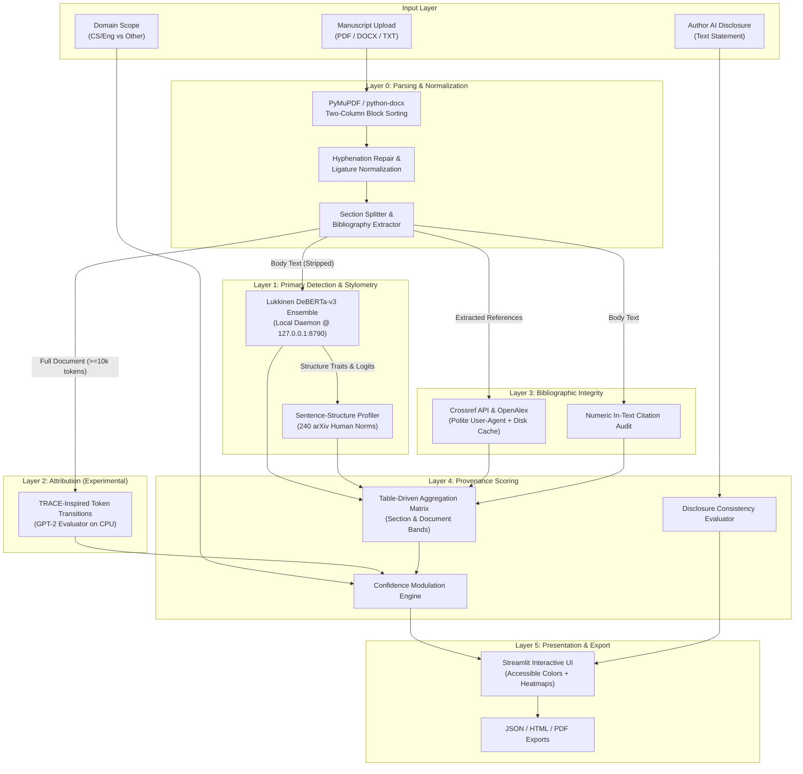
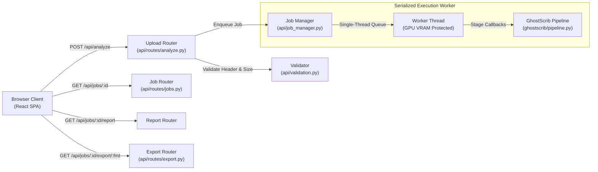

# GhostScrib: Architectural Design & Implementation Specification

## 1. System Overview

GhostScrib is a forensic manuscript analysis framework designed to assist scientific journal editors, program chairs, and peer reviewers. Rather than reducing the evaluation of AI involvement to an opaque, binary percentage ("72% AI"), GhostScrib produces structured, multi-dimensional transparency reports.

### High-Level Architectural Flow



---

## 2. Component Specifications

### 2.1 Layer 0: Parsing & Sanitization (`ghostscrib/parsing`)
- **PyMuPDF (`fitz`):** Multi-column academic PDFs are sorted by column bounding boxes ($x_0 \lessgtr \text{mid}_x$) before sorting by vertical coordinate $y_0$.
- **Hyphenation & Ligatures:** Restores words hyphenated across linebreaks (`micro-\nstructure` $\to$ `microstructure`) and normalizes standard typographical ligatures (fi, fl, ff).
- **Front Matter Isolation:** All metadata preceding the first recognized section heading (`Abstract` or `Introduction`) is classified as `Front matter` and marked `not_assessed` (excluded from model evaluation).
- **Bibliography Cutting:** The `References` / `Bibliography` section is extracted and stripped from the body to ensure references are never sent to the classifier.

### 2.2 Layer 1: Primary Detection & Stylometry (`ghostscrib/detection`, `ghostscrib/stylometry`)
- **Detector Service:** Isolated Python virtualenv hosting Luca D'Agati's `ai-text-detector` (`server.py`). Communicates over local loopback HTTP (`http://127.0.0.1:8790/api/detect`).
- **Ensemble Mechanics:** OR-ensemble of domain-tuned `DeBERTa-v3-base` models calibrated at 0.5% FPR each ($\le 1.0\%$ ensemble FPR on English CS/Engineering academic prose).
- **Whole-Document Request Mapping:** The body text is evaluated in a single request to obtain global `structure_traits` (z-scores against 240 human arXiv papers). Returned paragraph objects are mapped back to section models.
- **Stylometric Agreement:** Evaluates whether structural extreme traits ($|z| \ge 2.0$) corroborate or contradict the classifier verdict.

### 2.3 Layer 2: Forensic Attribution (`ghostscrib/attribution`)
- **TRACE-Inspired Profiler:** Implemented based on Shetty et al. (EMNLP / arXiv 2603.28054).
- **Evaluator Model:** `gpt2` operating on **CPU** (configurable via `GHOSTSCRIB_DEVICE`).
- **Feature Extraction:** 22-dimensional feature vector combining 4 rank bucket frequencies, a $4 \times 4$ bucket transition probability matrix, and predictive entropy mean/variance.
- **Guardrails:** Requires $\ge 10,000$ model tokens and $\ge 2$ candidate fingerprints. If conditions are not met, returns `status = unavailable` with clear explanation.

### 2.4 Layer 3: Citation Integrity (`ghostscrib/integrity`)
- **Query Sequence:** Primary DOI resolution via Crossref $\to$ Crossref bibliographic title search $\to$ OpenAlex search fallback.
- **Fuzzy Matching:** RapidFuzz token set ratio applied between extracted query and retrieved title.
- **In-Text Audit:** Extracts cited bracketed indices (e.g. `[1-3]`, `[5]`) and identifies any numbers that exceed the total bibliography count.
- **Persistent Caching:** Stores queries and responses in `data/cache/citations.json` to guarantee offline repeatability and speed.

### 2.5 Layer 4: Provenance Scoring (`ghostscrib/provenance`)
- Implements deterministic, pure table-driven rules (documented in `AGGREGATION_RULES.md`).
- Aggregates paragraph labels into section bands, computes document-level bands, clamps confidence, and checks disclosure consistency.

### 2.6 Layer 5: Presentation & Export (`app/streamlit_app.py`, `ghostscrib/report`)
- Streamlit web interface with accessibility tags, sentence heatmaps, and instant demo mode.
- Export pipelines:
  - JSON: Full typed Pydantic report dump.
  - HTML: Self-contained, responsive, CSS-styled HTML file.
  - PDF: Formatted executive summary via ReportLab.


---

## 3. Web Architecture Specification (FastAPI + React Vite)

### 3.1 Backend Architecture (`api/`)

The web backend is built with FastAPI and runs asynchronously, bridging the web client with the synchronous GhostScrib forensic pipeline.



#### Core Backend Modules
- **`api/main.py`**:
  - Configures FastAPI application with CORS middleware for Vite development (`http://localhost:5173`).
  - Registers route controllers under `/api`.
  - Implements SPA static serving: Mounts `frontend/dist/assets` and intercepts non-API requests to serve `frontend/dist/index.html`.
  - Privacy middleware: Logs request duration and HTTP method without recording manuscript text or sensitive payload parameters.
- **`api/job_manager.py`**:
  - Thread-safe in-memory job store backed by `threading.Lock` and `threading.Condition`.
  - Single-worker background thread (`GhostScribSingleWorker`): Strictly serializes pipeline execution to prevent GPU VRAM exhaustion on local inference hardware (minimum 4 GB VRAM envelope).
  - Progressive stage tracking: Updates job stage state across six milestones (`parsing`, `detection`, `stylometry`, `attribution`, `citations`, `scoring`).
  - TTL eviction: In-memory jobs and associated temporary files are evicted after 30 minutes (`JOB_TTL_SECONDS = 1800`).
- **`api/validation.py`**:
  - File extension and MIME type allowlist (`.pdf`, `.docx`, `.txt`).
  - Magic byte verification: Validates PDF header (`%PDF-`), DOCX zip container (`PK\x03\x04`), and plain text.
  - Size limitation: Rejects files $\ge 20$ MB with HTTP 413 (`file_too_large`).
  - Filename sanitization: Eliminates path traversal sequences (`../`, null bytes, control characters).
- **`api/errors.py`**:
  - Enforces the uniform error envelope across all endpoints: `{ "error": { "code": string, "message": string } }`.
  - Never leaks Python stack traces, internal file paths, or raw manuscript excerpts.

---

### 3.2 Frontend Architecture (`frontend/`)

The frontend is a single-page application built with React 18, Vite 5, TypeScript 5, and CSS Modules.

```
frontend/src/
├── api/                         # Typed REST client with error wrapping & mock mode
│   ├── client.ts                # Axios/fetch API abstraction
│   └── mockClient.ts            # Client-side 6-stage lifecycle mock runner (VITE_USE_MOCK=1)
├── components/shared/           # Design system tokens and reusable controls
│   ├── Badge.tsx                # Accessible text+color classification pills
│   ├── MetricCard.tsx           # Graded metric KPI display card
│   └── Toast.tsx                # Non-blocking user alerts
├── features/report/             # Modular report presentation features
│   ├── OverviewTab.tsx          # 6 core metric cards, summary banner, confidence reasons
│   ├── ExportBar.tsx            # One-click JSON, HTML, PDF download triggers
│   └── tabs/                    # Detail tabs (strictly ordered per contract)
│       ├── DocumentViewTab.tsx  # Interactive sentence highlighter & score tooltips
│       ├── AttributionTab.tsx   # Candidate model rankings & feature inspect
│       ├── CitationsTab.tsx     # Bibliographic verification data table
│       ├── BreakdownTab.tsx     # Stylometric z-scores & radar charts
│       └── LimitationsTab.tsx   # Methodological boundaries & disclaimers
├── pages/                       # Route views
│   ├── HomePage.tsx             # Manuscript upload, discipline picker, disclosure input
│   ├── AnalyzingPage.tsx        # Stage progression monitor with live animated stepper
│   ├── ReportPage.tsx           # Top-level tabbed report container
│   ├── AboutPage.tsx            # Methodology, privacy stance, and team disclosures
│   └── DevSandbox.tsx           # Isolated fixture preview workbench for developers
├── types/                       # Contract TypeScript models
│   ├── report.ts                # Canonical frontend data models
│   └── api.generated.ts         # Generated types from docs/openapi.json
└── theme.css                    # Design token CSS variables (colors, typography, spacing)
```

#### Frontend Design Tokens & Accessibility
- **Accessible Palette:** High-contrast color assignments paired with unambiguous text badges:
  - Human-like: Green (`#16a34a`) + `"Human-like"` label.
  - Uncertain: Amber (`#d97706`) + `"Uncertain"` label.
  - AI-like: Red (`#dc2626`) + `"AI-like"` label.
  - Not Assessed: Slate (`#64748b`) + `"(Excluded: under 40 words or non-prose)"` label.
- **Zero Color-Only Signaling:** WCAG 2.1 AA compliant; color is never used as the sole indicator of classification.

---

### 3.3 Cross-Platform Orchestration Scripts (`scripts/`)

To prevent operating-system incompatibilities between Windows PowerShell and Unix Bash, GhostScrib provides top-level Python orchestration scripts:

| Script | Purpose | Port Allocations | Description |
|---|---|---|---|
| `scripts/dev.py` | Development environment | `5173` (UI), `8000` (API), `8790` (Model) | Starts FastAPI (`--reload`), Vite dev server, and detector microservice; streams prefixed console outputs with clean Ctrl+C shutdown. |
| `scripts/serve.py` | Production single-port | `8000` (Unified), `8790` (Model) | Compiles web bundle if missing, verifies detector health, and launches FastAPI serving both API endpoints and built React SPA on port 8000. |
| `scripts/build_web.py` | Frontend build pipeline | None (CLI compiler) | Installs `frontend/node_modules` if absent, runs `tsc -b && vite build`, and verifies `frontend/dist/index.html`. |
| `scripts/verify_e2e_full.py` | E2E verification suite | `8000`, `8790` | Submits real PDF/DOCX/TXT manuscripts, audits exports, checks 5 failure modes, and captures headless Chrome screenshots. |
